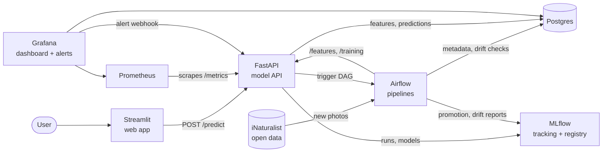
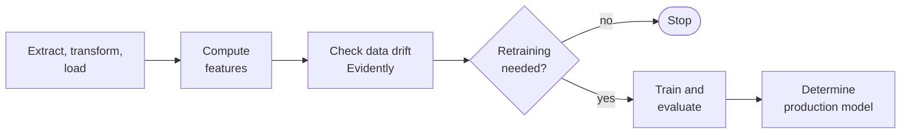
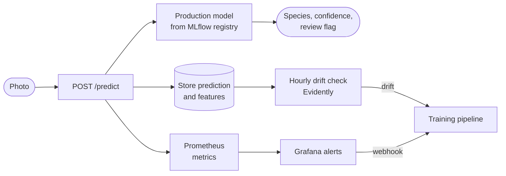

# Species ID

Species identification from photographs, maintained by an automated end-to-end MLOps pipeline.

A user submits a photo and gets a species with a confidence level. When the model is not sure
enough, the result is referred to human review. Behind that, the model is versioned, monitored,
and retrained automatically when the data changes.

Data comes from [iNaturalist](https://www.inaturalist.org): research-grade observations under
an open license only. The license and attribution of every photo are stored with it.

## Contents

- [Architecture](#architecture)
- [Quick start](#quick-start)
- [Training pipeline](#training-pipeline)
- [Prediction pipeline](#prediction-pipeline)
- [Monitoring and alerts](#monitoring-and-alerts)
- [Demo scenario](#demo-scenario)
- [Model and data](#model-and-data)
- [Development](#development)
- [Project layout](#project-layout)

## Architecture

Seven services, all started with Docker Compose:



| Service      | Role                                                                    | Address                    |
|--------------|-------------------------------------------------------------------------|----------------------------|
| `streamlit`  | Web app: identify a photo; also holds the defense presentation           | http://localhost:8501      |
| `api`        | FastAPI: features, training, prediction, metrics, alert webhook          | http://localhost:8000/docs |
| `airflow`    | Schedules the training pipeline and the prediction drift check           | http://localhost:8080      |
| `mlflow`     | Experiment tracking, artifacts, Model Registry, drift reports            | http://localhost:5001      |
| `grafana`    | Dashboard and alert rules                                                | http://localhost:3000      |
| `prometheus` | Metrics storage                                                          | http://localhost:9090      |
| `postgres`   | Application data, plus MLflow and Airflow metadata                       | localhost:5432             |

Airflow and Grafana log in with `admin` / `admin` by default (set in `.env`, local use only).
MLflow is on port 5001 because macOS uses 5000 for AirPlay.

## Quick start

Requirements: Docker and [uv](https://docs.astral.sh/uv/). About 6 GB of free memory for Docker.

```bash
cp .env.example .env
docker compose up -d --build              # all seven services
uv sync                                   # local Python environment
uv run python -m species_id.ingest        # one-time data load: 10 species x 300 photos
```

Airflow then runs the training pipeline on its daily schedule. To get a first model right
away, trigger the `training_pipeline` DAG in the Airflow UI, then open the Streamlit app.

## Training pipeline

The `training_pipeline` DAG runs daily, and on demand when monitoring asks for it.



1. **Extract, transform, load.** Airflow fetches new photos from the iNaturalist API. Only
   photos with an allowed license, hosted on the open-data bucket, are kept. Files go to
   `data/images/`; metadata, license and attribution go to Postgres.
2. **Compute features.** The API runs the frozen extractor on the new photos and caches the
   feature vectors in Postgres.
3. **Check data drift.** Evidently compares the photos the production model was trained on
   (reference) with the photos ingested since (current). The HTML report and metrics are
   logged to MLflow in the `species-id-monitoring` experiment.
4. **Retraining needed?** Training continues only if drift was detected, at least
   `RETRAIN_MIN_NEW_PHOTOS` photos have arrived, there is no production model yet, or the run
   was forced (alert, prediction drift, or a manual trigger with `{"force": true}`).
5. **Train and evaluate.** The API snapshots the dataset with DVC, fits the classification
   head, and logs parameters, metrics, the dataset hash and the model to MLflow as a new
   registered version. The current production model is re-scored on the same test set.
6. **Determine production model.** Airflow reads both scores from MLflow and moves the
   `production` alias to the new version unless it is worse by more than
   `PROMOTION_TOLERANCE` macro-F1. Each version is tagged `promoted` or `rejected`.

The API picks up a newly promoted version within 30 seconds, without a restart.

## Prediction pipeline

Predictions are served in real time.



- Every prediction is stored in Postgres with its feature vector, model version, confidence
  and review flag.
- Predictions below `CONFIDENCE_THRESHOLD` (default 0.6) come back with `needs_review: true`.
- The `prediction_drift` DAG runs hourly. It compares the features of recently submitted
  photos with those of the photos the model knows. Each prediction is checked once, and at
  least 30 new predictions are needed for a check. If drift is detected, the DAG triggers the
  training pipeline.

### API endpoints

| Endpoint                 | What it does                                                        |
|--------------------------|---------------------------------------------------------------------|
| `POST /predict`          | Identifies the species in an uploaded photo                          |
| `POST /training`         | Trains, evaluates and registers a model (`?promote=true` to also promote) |
| `POST /features`         | Computes extractor features for photos that lack them                |
| `GET /model`             | Describes the production model                                       |
| `GET /stats`             | Live figures: photos, licenses, predictions, drift checks, versions  |
| `POST /webhooks/grafana` | Receives Grafana alerts; starts the training pipeline when asked     |
| `GET /metrics`           | Prometheus metrics                                                   |
| `GET /health`            | Liveness check                                                       |

## Monitoring and alerts

Grafana is fully provisioned from `monitoring/grafana/`: data sources, the
"Species ID - API and model monitoring" dashboard, alert rules and the webhook contact point.

The dashboard shows request rate, latency, error rate, predictions per species, human-review
rate, mean confidence, production model version, drift check history and retraining triggers.

| Alert                  | Condition                                                 | Effect                          |
|------------------------|-----------------------------------------------------------|---------------------------------|
| High human-review rate | More than 30% of predictions flagged over 5 min (20+ predictions) | Triggers the training pipeline  |
| Slow predictions       | `/predict` p95 latency above 2 s                           | Notification only               |
| API server errors      | More than 5% of requests return a server error             | Notification only               |
| API down               | Prometheus cannot scrape the API                           | Notification only               |

Alerts go to the API's `/webhooks/grafana` endpoint through Grafana's built-in webhook
contact point. Alerts labelled `action: retrain` make the API start the Airflow training DAG.

Drift detection works on extractor features: the vectors are projected on 10 PCA axes fitted
on the reference sample, and each axis is tested with Kolmogorov-Smirnov (p < 0.05). Drift is
declared when at least half of the axes have drifted.

## Demo scenario

With the stack running and a production model in place:

```bash
uv run python scripts/simulate_traffic.py --n 100            # normal photos
uv run python scripts/simulate_traffic.py --n 100 --drift    # grey, blurred, dark photos
```

- Normal photos: almost none are flagged for review, and the drift check stays quiet.
- Degraded photos: most are flagged for review. Within about two minutes the
  "High human-review rate" alert fires and a forced `training_pipeline` run appears in
  Airflow. Triggering `prediction_drift` in Airflow (or waiting for the hourly run) also
  detects the drift and triggers training.

Watch it happen on the Grafana dashboard, then find the drift reports in MLflow under the
`species-id-monitoring` experiment.

## Model and data

- **Species.** Ten well-represented, visually distinct species (insects, birds, mammals, a
  plant and a fungus), listed in `src/species_id/config.py`.
- **Model.** A frozen pre-trained extractor from `timm` (`mobilenetv3_large_100` by default)
  followed by a logistic-regression head. Features are cached in Postgres, so retraining only
  refits the head and takes seconds on a CPU. Test accuracy is about 94%.
- **Database.** `taxa`, `photos` (with license and attribution), `embeddings`, `predictions`
  and `drift_checks`.
- **Dataset versioning.** DVC without Git, with its project inside `data/`. The directory hash
  from `data/images.dvc` is logged to every MLflow run as `dataset_md5`, and the `.dvc` file
  is attached to the run.
- **Train/test split.** Deterministic, by observation id: one observation in five is test.

## Development

```bash
uv run ruff check .
uv run pytest -q
```

CI (`.github/workflows/ci.yaml`) runs the linter, the unit tests and the Docker builds.

Training and prediction can also run on the host against the Docker services:

```bash
uv run python -m species_id.training
uv run python -m species_id.predict path/to/photo.jpg
```

Settings are environment variables, documented in `.env.example`.

## Project layout

```
src/species_id/
  config.py       settings and the list of species
  schema.sql      database schema
  ingest.py       iNaturalist -> database
  features.py     frozen feature extractor
  versioning.py   DVC dataset snapshot
  training.py     train + evaluate + MLflow tracking
  registry.py     MLflow Model Registry: load and promote
  predict.py      single-image prediction
  drift.py        Evidently drift checks and the retraining decision
  metrics.py      Prometheus metrics
  api.py          FastAPI app
dags/             Airflow DAGs: training_pipeline, prediction_drift
streamlit_app/    Streamlit web app and defense presentation
docs/DEFENSE.md   defense guide: timing, demo script, likely questions
monitoring/       Prometheus config; Grafana data sources, dashboard and alerts
docker/           Dockerfiles and database init
scripts/          traffic simulator for demos
tests/            unit tests
```
